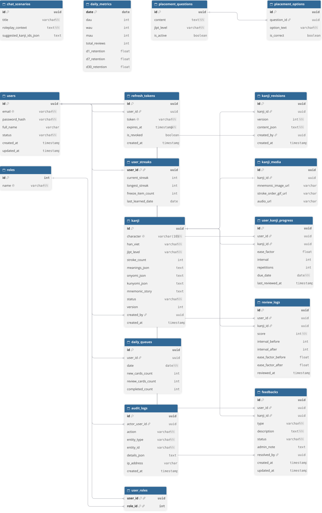

# SDD: Software Design Document

| Phiên bản : 1.0 | Ngày : 02-11-2026 | Trạng thái : Draft | Cổng : R1-G2 | Người duyệt : Nguyễn Tấn Mạnh |

### ERD Diagram

### Danh sách các phân hệ bảng CSDL
1. **Phân hệ Core Learning:**
   - **Xác thực và quản lý người dùng:** `users`, `roles`, `user_roles`, `refresh_tokens`, `user_streaks`
   - **Nội dung Kanji và Media:** `kanji`, `kanji_media`
   - **Tiến độ SM-2 và học tập:** `user_kanji_progress`, `review_logs`, `daily_queues`
   - **Đánh giá và chat:** `placement_questions`, `placement_options`, `chat_scenarios`

2. **Phân hệ Admin System:**
   - **Truy vết:** `audit_logs`
   - **Quản lý phiên bản:** `kanji_revisions`
   - **Tiếp nhận báo lỗi:** `feedbacks`
   - **Báo cáo và analytics:** `daily_metrics`

### Sm2EngineService
- **Input:** `kanji_id`, `rating` kiểu int từ 0->5, `time_taken_ms` kiểu int.
- **Processing Logic:**
  - Tiếp nhận `rating` từ API. Ánh xạ từ UI: `Again = 1`, `Hard = 3`, `Good = 4`, `Easy = 5`.
  - Kiểm tra điều kiện:
    - Nếu `rating >= 3`: Đánh dấu thành công. Cập nhật `repetitions = repetitions + 1`. Tính `interval` mới theo công thức I(n) = I(n-1) x EF. Cập nhật trạng thái thẻ sang `Learning`, `Review` hoặc `Mastered`.
    - Nếu `rating < 3`: Đánh dấu thất bại (Quên). Reset `repetitions = 0`, `interval = 1`.
  - Cập nhật hệ số dễ EF' = EF + (0.1 - (5 - q) x (0.08 + (5 - q) x 0.02))$, giới hạn EF >= 1.3.
  - Lưu bản ghi lịch sử vào `ReviewLogs` chứa `rating` và `time_taken_ms`.

